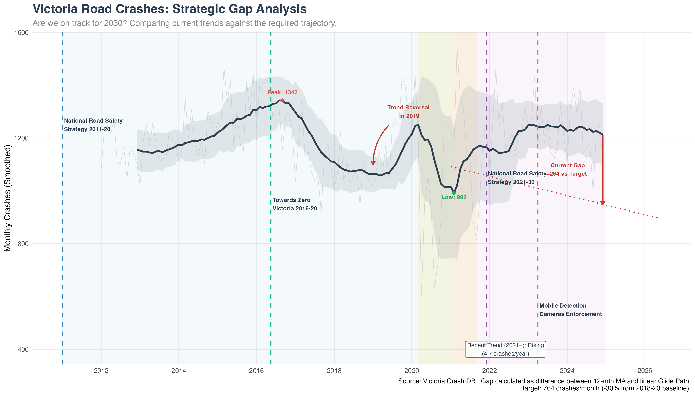
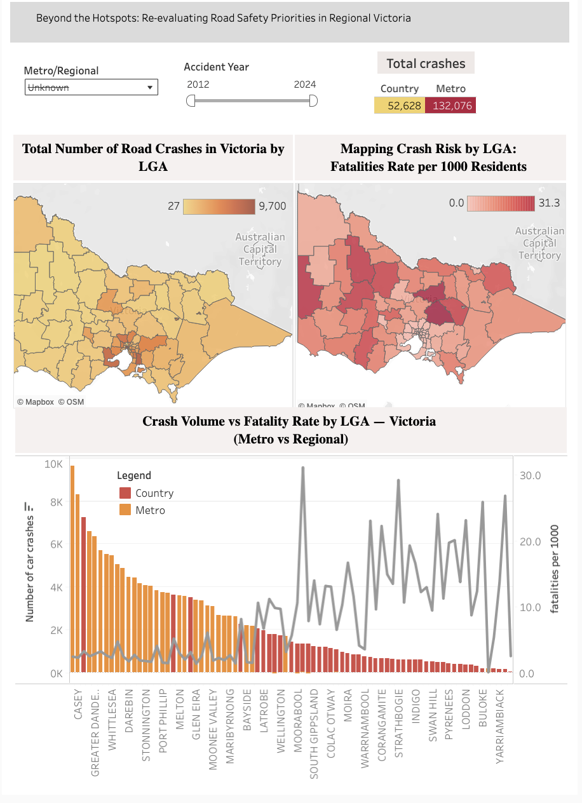
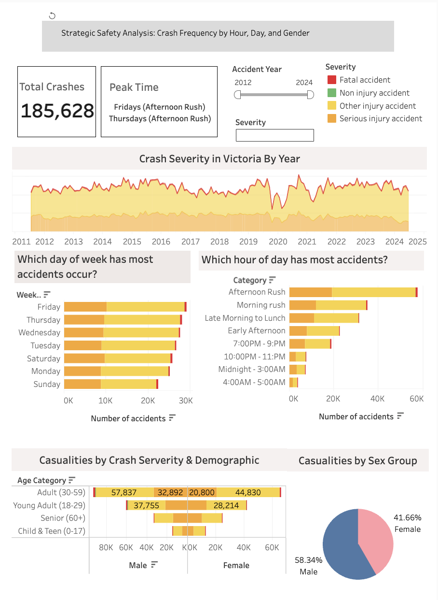
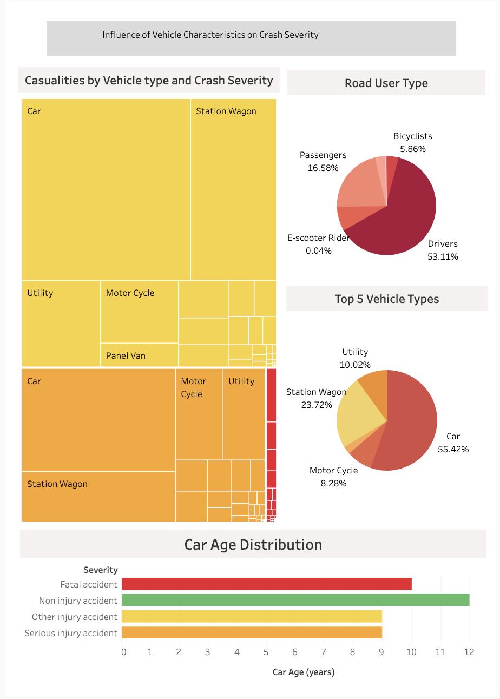

# Victoria Road Crash Analysis (2012–2024)

**Victoria counts crashes. Its deaths are somewhere else.**

Thirteen years of Victorian police-reported crash records (**184,699 crashes, 3,318 deaths and 76,174 people seriously injured**), analysed in Tableau, R and Python. The study measures each question in deaths and serious injuries, not crash counts, and traces every death to a road, an hour, a crash type, a person and a car. Each recommendation is tied to the finding it answers, with an owner, a rule for where it starts, and a measure.

**Case study website:** https://racheltran184.github.io/Tableu-Project-1/

---

## The question

Victoria's Road Safety Strategy 2021–2030 aims to **halve road deaths by 2030** and cut serious injuries. A crash-count dashboard shows where traffic is. It doesn't show where people die, so it can't say where a barrier, a lower speed limit or a patrol hour saves a life.

| Who asks | What they need to know |
|---|---|
| Road safety leadership | Are deaths on track to halve by 2030, and what is driving the gap? |
| Transport planning | Which roads should get barriers, line marking or a lower limit first? |
| Police | Which hours and roads should enforcement cover to prevent the most deaths? |
| Accident insurer | Which road users and vehicles need their own program? |

**How to read the numbers**
- **Measure:** deaths and serious injuries. Most crashes injure without killing.
- **Rates:** "deaths per 100 crashes" shows how lethal a crash is in a place, hour or crash type. The data has no traffic volumes or population by year, so it is **not risk per kilometre driven**.
- **Scope:** police-reported injury crashes, January 2012 to December 2024. Serious injuries for 2024 fall by a fifth while crashes hold steady, so 2024 serious-injury figures are treated as provisional.

---

## Key findings

| # | Finding | Evidence |
|---|---|---|
| 1 | **Deaths are rising, away from the 2030 line** | From the 2018–20 average of 230 deaths a year, a straight line to half reaches 115 in 2030 and sits at 184 in 2024. Deaths were 295 in 2023 and 284 in 2024: **100 above the line**, while crashes held at about 14,500 a year. |
| 2 | **Most crashes don't kill. Leaving the lane does** | Running off the road or losing control: 23% of crashes, **40% of deaths**. Head-on: 3% of crashes, **16% of deaths** (8.7 per 100 crashes). Rear-end: 18% of crashes, 5% of deaths. Lane departures are 56% of all deaths and 69% of regional deaths. |
| 3 | **The busiest hour is not the deadliest** | Crashes peak from 3 to 6 pm (1.4 deaths per 100 crashes). From 10 pm to 6 am: **10% of crashes, 20% of deaths**; midnight to 4 am reaches 4.2–4.7 per 100. Friday has the most crashes; Saturday has the most deaths. |
| 4 | **A quarter of deaths: one road type, one crash type** | Lane departures on undivided regional 100–110 km/h roads: **9,998 crashes (5.4%), 785 deaths (24%)**, 7.9 deaths per 100 crashes. 100 km/h roads see 5.4 deaths per 100 crashes, 60 km/h roads 1.1. |
| 5 | **Twelve highways carry a quarter of regional deaths** | The regional sections of 12 roads hold 23% of regional deaths on 11% of regional crashes. The Murray Valley, Western, Northern, Goulburn Valley, Glenelg and Hamilton highways kill 9–11 people per 100 crashes. Moira (7.4), Corangamite (7.1), Strathbogie (6.8) and Hepburn (6.8) have the highest council rates. |
| 6 | **The rise came from two kinds of road** | Deaths went from 230 a year (2018–20) to 290 (2023–24). **Melbourne roads of 90 km/h or less: +32 a year**; **regional 100–110 km/h roads: +29**. Motorcyclist deaths rose from 37 to 55 a year. |
| 7 | **The people most likely to die in a crash** | Without a seatbelt, 4.6% of occupants died, against 0.5% with one (**9×**); unbelted deaths are 85% male, 68% regional, and 24% of occupant deaths have the belt recorded as unknown. 6.7% of pedestrians aged 70+ who were hit died. Motorcyclists are 6% of people in crashes and 17% of deaths. |
| 8 | **Old cars turn crashes into deaths** | Driver deaths per 1,000 drivers in a crash: **2.9 in a car under 5 years old, 13.0 at 20+ years**. Cars 15+ years old are 25% of drivers in crashes and 44% of driver deaths. The gap holds on the same roads, for drivers of the same age, and with a seatbelt on. |

---

## Actions

Each action answers one finding and is measured in its own deaths and serious injuries. Sizes are counts from 2012–2024, not forecasts of lives saved.

### Roads (transport planning)
| Action | Why | Starts where | Measure |
|---|---|---|---|
| **01 Treat lane departure on 12 highways:** flexible barriers, wide centre lines, audio-tactile line marking | 785 deaths (24%) from 5.4% of crashes | Sections ranked by five-year lane-departure deaths and serious injuries; Murray Valley, Northern, Goulburn Valley and Western highways first | Lane-departure deaths and serious injuries, treated against untreated sections |
| **02 Lower the limit where works are years away:** 100 → 80 km/h review | 5.4 deaths per 100 crashes at 100 km/h against 2.0 at 80 km/h | Top quarter of undivided sections with no barrier funded within two years | Mean speed and serious crashes before and after; keep where harm falls over 24 months |
| **03 Fix Melbourne's 60–80 km/h arterials:** raised platforms, roundabouts, protected right turns, roadside protection | Melbourne deaths on roads ≤ 90 km/h rose from 88 to 120 a year | Nepean Highway, Ballarat Road, Ferntree Gully Road, Stud Road | Deaths and serious injuries at treated sites |

### Police
| Action | Why | Starts where | Measure |
|---|---|---|---|
| **04 Move patrol hours to nights and weekends** | 10% of crashes, 20% of deaths at night; 386 of 677 night deaths followed a car leaving the road | 10 pm–6 am and weekends on the action 01 corridors | Night deaths per 100 crashes, regional |
| **05 Check seatbelts on regional roads at night** | Unbelted occupants die at 9× the belted rate; unbelted deaths are 68% regional, 85% male | Every night and weekend operation on regional 100–110 km/h roads | Unbelted share of occupant deaths (16% now) |
| **06 Record the belt at every death** | 504 occupant deaths (24%) have belt status unknown | Every occupant killed or seriously injured | Belt status unknown (target: under 5%) |

### Road users and vehicles (accident insurer, councils)
| Action | Why | Starts where | Measure |
|---|---|---|---|
| **07 A rider program for lane departure:** barrier underrun protection, rider training | Rider deaths rose from 37 to 55 a year; 221 of 549 followed leaving the road | Corridor sections where riders crash | Rider deaths by crash type |
| **08 Slow traffic where older people walk:** 40 km/h, longer crossing times | 6.7% of pedestrians aged 70+ who are hit die; 72% of pedestrian deaths are in Melbourne | Melbourne shopping strips, aged-care and health precincts | Pedestrian deaths and serious injuries, aged 70+ |
| **09 Trade up old cars, regional first** | Cars 15+ years old: 25% of drivers in crashes, 44% of driver deaths | Councils on the corridor list (32% of regional crash-involved cars are 15+) | Share of crash-involved cars aged 15+; driver deaths per 1,000 |

### Measurement (road safety leadership)
| Action | Why | Measure |
|---|---|---|
| **10 Report deaths against the line every quarter**, by regional highways, Melbourne arterials, riders and pedestrians | 2024 ended 100 deaths above the line while crashes held flat | Deaths against the line (173 in 2025, 115 in 2030) |
| **11 Add exposure:** traffic counts, section lengths, council population by year | Works are funded by section, so the ranking needs deaths per kilometre driven | Corridor sections ranked per 100 million km |

---

## Dashboards

### Trend (R)
Monthly crashes with a 12-month moving average, the national and state strategy periods, and a crash-count glide path.



### Where (Tableau)
Crashes and fatalities per 1,000 residents by council area, with crash volume against fatality rate for each council.



### When and who (Tableau)
Severity by year, crashes by weekday and time of day, and casualties by age group and sex.



### Vehicles (Tableau)
Casualties by vehicle type and severity, road user types, top vehicle types and average car age by severity.



---

## Method

1. **Join:** crashes to people on `ACCIDENT_NO`; drivers to their car on `ACCIDENT_NO` + `VEHICLE_ID`; councils to `LGA_POLYGON.shp` in Tableau.
2. **Classify:** one crash type per crash from the police DCA codes (pedestrian struck, head-on, ran off the road or lost control, intersection, rear-end, other). **Lane departure** = ran off the road, lost control or head-on.
3. **Weigh:** share of deaths against share of crashes; deaths per 100 crashes; deaths a year against a straight line from the 2018–20 average to half by 2030.
4. **Locate:** Melbourne (Metro) or regional (Country) by speed zone and divided/undivided road; regional roads ranked by deaths; deaths per 100 crashes by clock hour.
5. **Control:** car age compared within the same road type, the same driver age group and among belted drivers only.

**Data checks**

| Check | Result | Handling |
|---|---|---|
| One row per crash | 184,699 crashes, no repeated crash numbers | Passed |
| People without a crash | 4,653 of 436,360 person records (1.1%) | Left out of person-level rates |
| Seatbelt status | 24% of occupant deaths recorded as unknown | Unbelted figures read as a floor |
| Year of manufacture | 97.7% usable | Car age only where valid |
| Serious injuries in 2024 | 4,525 against 5,618 in 2023 (−19.5%) | Treated as provisional |
| Exposure | No traffic volumes, road lengths or yearly population | Rates per crash or per person in a crash |

---

## Reproduce

```bash
pip install pandas numpy
python3 analysis/deep_dive.py Data site_data.json
```

`analysis/deep_dive.py` reads the three gzipped tables in `Data/` and writes every figure used on the website to one JSON file. The code blocks shown on the website are taken from this script.

---

## Tools

- **Tableau:** three dashboards and the council map (`Victoria Car Crash Analysis.twb`)
- **R (ggplot2):** monthly trend and glide path (`Victoria Road Crash Trend.R`)
- **Python (pandas):** crash typing, harm weighting, corridors, people and vehicle analysis (`analysis/deep_dive.py`)

## Data assets

| File | Contents |
|---|---|
| `Data/crash1.csv.gz` | One row per crash: date, hour, location, council, speed zone, road, crash type (DCA), severity, deaths and serious injuries |
| `Data/person1.csv.gz` | One row per person: age group, sex, road user type, injury level, seatbelt or helmet |
| `Data/vehicle1.csv.gz` | One row per vehicle: type, year of manufacture, body style |
| `Data/hour.csv` | Hour-to-time-band mapping used in Tableau |
| `Data/LGA_POLYGON.shp` | Council boundaries for the Tableau map |
| `Data/data_dictionary.xlsx` | Field definitions |

The per-1,000-resident map in the Tableau workbook uses a council population file (`LGA_Year_Population_Victoria.csv`) that is not included in this repository.

## Repository structure

```text
Tableu-Project-1/
├── index.html                          # case study website (GitHub Pages)
├── analysis/
│   └── deep_dive.py                    # Python analysis behind the website
├── Data/
│   ├── crash1.csv.gz
│   ├── person1.csv.gz
│   ├── vehicle1.csv.gz
│   ├── hour.csv
│   ├── LGA_POLYGON.shp
│   └── data_dictionary.xlsx
├── visualizations/
│   ├── strategic_gap_analysis.png
│   ├── metro_vs_regional_risk.png
│   ├── temporal_demographics_dashboard.png
│   └── vehicle_characteristics_dashboard.png
├── Victoria Car Crash Analysis.twb
├── Victoria Road Crash Trend.R
├── Report.pdf
└── README.md
```

---

**Project:** BUSA8090 Data and Visualisation for Business, Macquarie University, 2025.
**Author:** Rachel Tran · [Portfolio](https://racheltran.vercel.app/) · [LinkedIn](https://www.linkedin.com/in/racheltran184/) · racheltran184@gmail.com

*Figures come from Victoria's open road crash data as published in this repository and may differ from official road toll counts. Counts describe the past; they are not forecasts of lives saved.*
